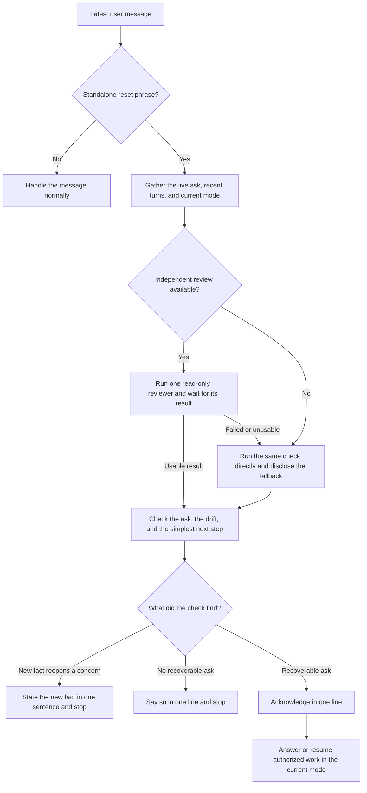

# what...?

You asked for a small fix. It came back with a migration plan.
You said “go ahead.” It gave you another plan.
You corrected one thing. It changed five.

> what...?

That’s the whole prompt. It tells the assistant to look back at what you
actually asked, catch where it went sideways, and pick up from there.

## How that sounds

> **You** — Can we riff on a name for this feature?  
> **Assistant** — I’ll build the feature and add it to the nav.  
> **You** — what...?  
> **Assistant** — I jumped ahead. We’re still naming it.  
> **Assistant continues** — I’d start with “Peek” if it’s a quick look, or “Preview” if you want the button to be obvious.

## What happens next

When the chat can run a second agent, the assistant asks one read-only reviewer
what you wanted, where the reply went sideways, and what would get things back
on track. If that check is unavailable, the assistant says so and does it
itself. Either way, you get one line of acknowledgment before it gets back to
the ask. If there’s no clear ask to recover or a new fact brings back a real
blocker, it says so and stops.
[Subagent docs](https://learn.chatgpt.com/docs/agent-configuration/subagents)

## Install

If you have access to the private plugin, open its listing and install it in
Codex or ChatGPT. If you have the source, use this folder as the source package
for your own private plugin in Plugin Creator. The package has one skill and
needs no server, credentials, or build step.

For a standalone Codex install, copy the `skills/what-reset` directory into
`~/.agents/skills/` and start a new chat. The installed path should be
`~/.agents/skills/what-reset/SKILL.md`.

## Flowchart of change

## License

[MIT](LICENSE)
